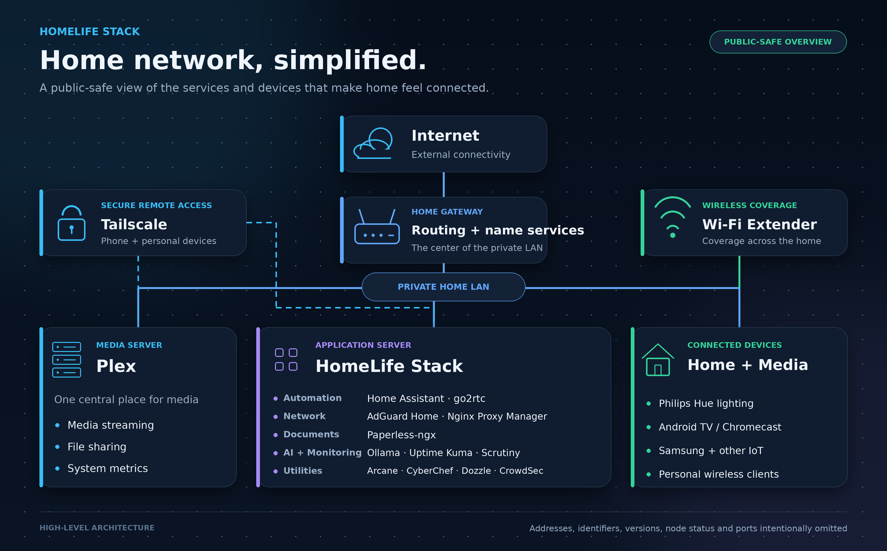

# HomeLife-Stack

A simple, clean stack of services that simplifies everyday life and saves space and clutter on your devices—one central location for everything.

## What this stack does

HomeLife-Stack brings media, home automation, documents, AI tools, and monitoring together in one home-hosted environment.

| Area | Services | Purpose |
|---|---|---|
| Media | Plex | Centralized media streaming and library access |
| Home automation | Home Assistant, go2rtc, Philips Hue | Smart-home control, lighting, and camera/stream integration |
| Network services | AdGuard Home, Nginx Proxy Manager | DNS-based filtering and a shared application entry point |
| Documents | Paperless-ngx | Document organization and paperless workflows |
| AI and monitoring | Ollama, Uptime Kuma, Scrutiny | Local AI, service monitoring, and storage-health visibility |
| Utilities | Arcane, CyberChef, Dozzle, CrowdSec | Container management, data tools, logs, and security support |

## Architecture at a glance

- A private home network connects the media server, application server, and household devices.
- The application server runs the HomeLife services as isolated containers, with host-networked components where appropriate.
- Paperless-ngx uses dedicated database and cache services within its application stack.
- A Wi-Fi extender supports household wireless coverage.
- Tailscale provides secure remote access for personal devices without exposing the detailed network design in this public document.

## Public documentation policy

This README is intentionally high-level. It does not publish IP addresses or subnets, hostnames, hardware identifiers, operating-system or application versions, port assignments, container addresses, Tailscale identifiers, device histories, credentials, or runtime data.

Detailed inventories and operational configuration should remain in appropriately secured private documentation.
